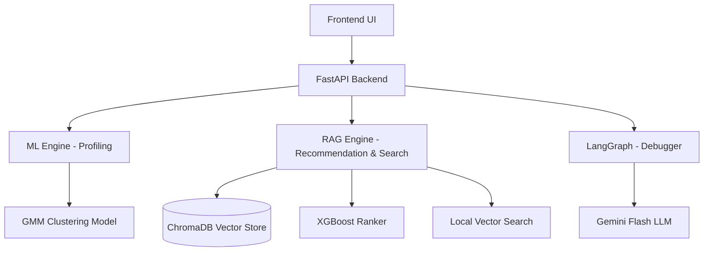
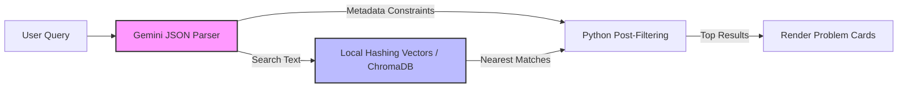
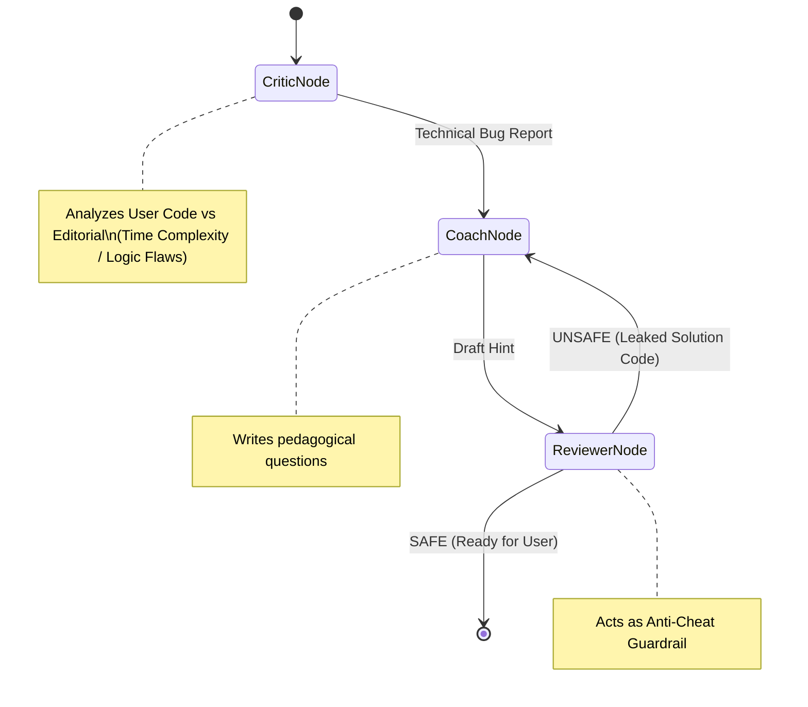

# Codeforces Coach — Advanced AI Training Platform

An intelligent competitive programming training system. It goes beyond simple problem recommendations by providing **Self-Querying Semantic Search**, **ML-driven Behavioral Profiling**, and a **LangGraph-powered Autonomous Socratic Debugger** to act as your personal Codeforces mentor.

---

## Core Features

| Feature | Description |
|---|---|
| **Profile Analysis** | Scrapes your CF history and engineers behavioral features. Trained GMM artifacts enable archetype classification; a rating-based estimate is used when they are absent. |
| **Practice Recommender** | Finds a fresh problem from the local ChromaDB index and uses XGBoost ranking when its trained model is present, otherwise ranking by target rating. Gemini presentation is optional. |
| **Concept Search** | Find problems using natural-language queries, ChromaDB vector search, and rating/tag filters. Local hashed embeddings work without downloading a model. |
| **Self-Querying Retriever** | Uses Gemini when configured to extract rating/tag constraints, then applies strict **Post-Filtering** in Python. Plain searches work without an API key. |
| **Agentic Socratic Debugger** | A **LangGraph** multi-agent state machine (Critic, Coach, Reviewer). It analyzes your failing code against the official editorial and provides Socratic hints without leaking the solution! |
| **Negative Pruning** | Automatically filters out problems the user has already attempted from the recommendation pool. |

---

## System Architecture

### 1. Overall Platform Data Flow


### 2. The Practice Recommendation Pipeline (ML + RAG)
1. **Profile:** Scrapes Codeforces submissions and engineers behavioral features; trained GMM models are optional.
2. **Query Building:** Gemini optionally generates targeted ChromaDB search keywords and rating bounds; a local profile-based query is used otherwise.
3. **Candidate Retrieval:** ChromaDB retrieves vector-matched candidate problems within the rating window.
4. **Negative Pruning:** Filters out every problem the user has already attempted.
5. **Ranking:** XGBoost scores candidates when its model is present; otherwise the closest target-rated problem is selected.
6. **Presentation:** Gemini presents the selected problem when configured; a local description is used otherwise.

### 3. Self-Querying Concept Search


### 4. LangGraph Socratic Debugger


---

## Behavioral Archetypes (GMM Clusters)

| # | Name | Rating Range | Key Trait |
|---|------|-------------|-----------|
| 0 | The Cautious Beginner | ~1090 | High accuracy, weak Data Structures |
| 1 | The Impatient Novice | ~1170 | Over-relies on Greedy, high abandonment |
| 2 | The Persistent Grinder | ~970 | Great grit, lacks theory |
| 3 | The Fickle Advanced | ~1560 | Strong skills, overwhelmed easily |
| 4 | The Stubborn Graph Hacker | ~1665 | Graph expert, panic submitter |
| 5 | The Comfort Zone Camper | ~880 | Pads stats with easy problems |
| 6 | The Methodical Optimizer | ~1190 | Disciplined, ready for next level |
| 7 | The Solid Specialist | ~1420 | DP & Graph focused |
| 8 | The Advanced Precisionist | ~1560 | One-shot accuracy, clean code |
| 9 | The Frustrated Flounderer | ~980 | Guesses often, tilts quickly |

---

## Project Structure

```
cf_coach/
├── backend/
│   ├── main.py                # FastAPI endpoints
│   ├── ml_engine.py           # Feature engineering, GMM classification
│   ├── chat_engine.py         # Recommendation, Search, & LangGraph logic
│   ├── config.py              # Centralized environment configs
│   ├── persona_prompts.py     # 10 archetype persona definitions
│   ├── pipeline.py            # ChromaDB ingestion script (open-r1/codeforces)
│   ├── models.py              # SQLAlchemy database ORM
│   ├── requirements.txt       # Backend dependencies
│   ├── .env                   # API keys (NOT TRACKED)
│   └── static/                # Vanilla HTML/JS frontend (Glassmorphism)
│
├── train/                     # Jupyter notebooks for ML training (GMM, XGBoost)
└── .gitignore                 # Secured Git ignores
```

---

## Getting Started

### Prerequisites
- Python 3.10+
- A [Google Gemini API Key](https://aistudio.google.com/app/apikey) for Gemini-powered hints, code review, and query parsing

### 1. Installation
```bash
git clone https://github.com/<your-username>/cf_coach.git
cd cf_coach/backend
python -m venv venv
.\venv\Scripts\Activate.ps1
python -m pip install -r requirements.txt
```

### 2. Configure Environment
Create `backend/.env`:
```env
GEMINI_API_KEY=your_gemini_api_key_here
CHROMA_COLLECTION_NAME=cf_problems
```

### 3. Initialize Database & ML Models
1. Run these commands from `backend/` to populate SQLite and build the local ChromaDB problem index:
   ```bash
   python pipeline.py --step 1
   python pipeline.py --step 2
   python pipeline.py --step 3
   ```
2. Optionally run `python pipeline.py --step 4` from `backend/` to ingest editorial data for hints and editorial search.
3. **Optional ML model weights** — Train from the notebooks in `train/` (GMM & XGBoost). The app uses profile-based fallbacks if those model files are unavailable.

### 4. Run the Server
```bash
uvicorn main:app --reload --host 0.0.0.0 --port 8000
```
The API will be available at `http://<your-machine-ip>:8000`. Access the Swagger docs at `/docs` endpoint.

This app instance is configured for the Codeforces account `vaibhavreddy` (Vaibhav Reddy). Add `GEMINI_API_KEY` to `backend/.env` to enable Gemini-powered features.

---

## Tech Stack
- **Backend:** FastAPI, Uvicorn, SQLAlchemy
- **Agentic Workflow:** LangGraph, LangChain
- **Vector DB / RAG:** ChromaDB, scikit-learn HashingVectorizer
- **Machine Learning:** scikit-learn (GMM), XGBoost, Pandas
- **LLM:** Google Gemini 3.1 Flash-Lite
- **Frontend:** HTML/CSS/JS (Vanilla + KaTeX for math rendering)

---
